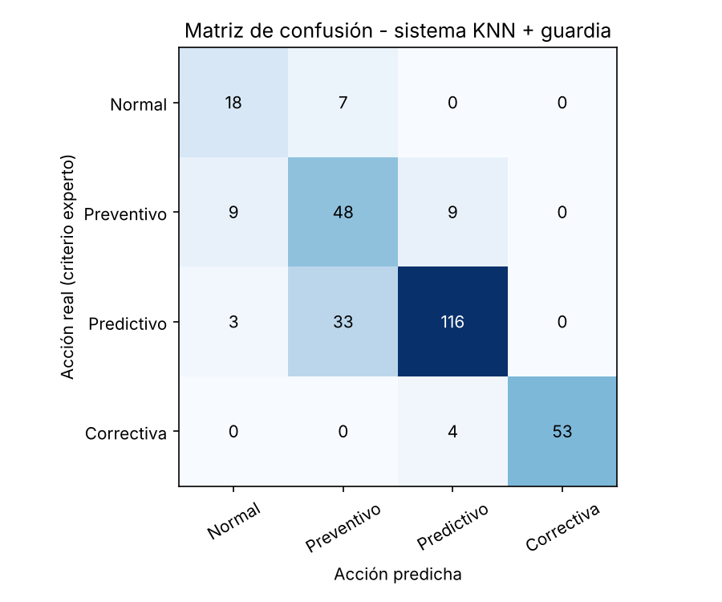

# AI_Project — Sistema de recomendación de mantenimiento para transformadores

**Asignatura:** Inteligencia Artificial Aplicada al Mantenimiento (IEA503) — INACAP Sede Ñuñoa
**Actividad:** Actividad formativa GitHub Copilot (Unidad 3, Semana 14)
**Estudiante:** Diego Zamora — Ingeniería Eléctrica
**Docente:** Antonio Armando Alvarado García

---

## 1. Objetivo

Explorar GitHub Copilot como herramienta de desarrollo asistido por IA, aplicándola a un problema real de la especialidad: **recomendar la acción de mantenimiento adecuada para un transformador de potencia en aceite** a partir de sus pruebas de diagnóstico.

La guía de laboratorio propone un sistema de recomendación genérico con `KNeighborsClassifier` sobre un `products.csv`. Este proyecto mantiene la misma estructura (carga de datos → preprocesamiento → división train/test → KNN → evaluación → función `recommend()`), pero la lleva a un caso de mantenimiento eléctrico y corrige debilidades del ejemplo original (ver sección 6).

## 2. Estructura del repositorio

```
AI_Project/
├── recommendation_system.py   # Código principal (generado con apoyo de Copilot)
├── requirements.txt           # Dependencias de Python
├── .gitignore
├── README.md                  # Este documento
├── data/
│   └── transformadores.csv    # Historial sintético de 1.500 unidades (se genera si no existe)
└── docs/
    ├── matriz_confusion.png   # Resultado de la evaluación
    ├── salida_ejecucion.txt   # Salida completa de consola
    └── capturas/              # Capturas de pantalla del proceso
```

## 3. Proceso seguido (paso a paso)

### Paso 1 — Cuenta en GitHub y beneficio de estudiante
Se creó la cuenta en <https://github.com> con el correo institucional y se validó el correo. Luego se solicitó el beneficio **GitHub Education** (<https://education.github.com>), que habilita GitHub Copilot sin costo para estudiantes verificados. Desde *Pricing* se seleccionó el plan **Free**.


### Paso 2 — Creación del repositorio
Desde el *Dashboard* → **New** se creó el repositorio `AI_Project`, con README inicial, `.gitignore` (plantilla Python) y visibilidad **pública** para que el docente pueda revisarlo con el enlace.


### Paso 3 — Clonar el repositorio en Visual Studio Code
Con la extensión **GitHub Copilot** instalada en VS Code y la sesión iniciada, se clonó el repositorio desde el terminal integrado:

```bash
git clone https://github.com/<usuario>/AI_Project.git
cd AI_Project
```


### Paso 4 — Generar el código con GitHub Copilot
Se creó `recommendation_system.py`. El código se construyó escribiendo **comentarios descriptivos como instrucciones** y aceptando/corrigiendo las sugerencias de Copilot (tecla `Tab`), además de consultas en **Copilot Chat**. Prompts utilizados:

| # | Prompt (comentario o chat) | Resultado aceptado / ajustado |
|---|---|---|
| 1 | `# Importar las librerías necesarias para un clasificador KNN con sklearn` | Imports base (numpy, pandas, sklearn) |
| 2 | `# Generar un dataset sintético de transformadores con gases disueltos H2, CH4, C2H2, C2H4, C2H6, CO, índice de polarización, rigidez dieléctrica, humedad, temperatura, carga y edad` | Función `generar_dataset()` con distribuciones log-normales |
| 3 | `# Clasificar la condición de cada gas según los límites de IEEE C57.104` | Función `condicion_gas()`; límites verificados manualmente contra la tabla de la norma |
| 4 | Chat: *"¿Por qué debo escalar las variables antes de usar KNN?"* | Se agregó `StandardScaler` y transformación logarítmica de gases |
| 5 | `# Buscar el mejor número de vecinos con validación cruzada estratificada` | `GridSearchCV` con `StratifiedKFold` |
| 6 | `# Función que recomiende una acción de mantenimiento y muestre los casos más parecidos` | Función `recommend()` con vecinos más cercanos |


> **Observación de ingeniería:** Copilot acelera la escritura, pero no garantiza criterio técnico. Los límites normativos, umbrales de alarma y la lógica de seguridad fueron revisados manualmente contra las normas citadas. Toda sugerencia se trató como un borrador a validar.

### Paso 5 — Ejecución

```bash
pip install -r requirements.txt
python recommendation_system.py
```


### Paso 6 — Commit y Push

```bash
git add .
git commit -m "Add recommendation system example"
git push -u origin main
```


## 4. Descripción técnica del modelo

### 4.1 Variables de entrada

| Variable | Unidad | Prueba / norma de referencia |
|---|---|---|
| H2, CH4, C2H2, C2H4, C2H6, CO | ppm | Análisis de gases disueltos (DGA) — IEEE C57.104 / IEC 60599 |
| PI | — | Índice de polarización (R10min/R1min) — IEEE Std 43 |
| rigidez_kV | kV | Rigidez dieléctrica del aceite — IEC 60156 / IEC 60422 |
| humedad_ppm | ppm | Contenido de agua en aceite (Karl Fischer) — IEC 60814 |
| temp_aceite_C | °C | Temperatura de aceite superior |
| carga_pct | % | Carga respecto a la potencia nominal |
| edad_anios | años | Antigüedad del equipo |
| TDCG *(derivada)* | ppm | Gases combustibles totales disueltos |
| indice_DGA *(derivada)* | — | Peor gas / límite de Condición 3 (> 1 ⇒ Condición 4) |

### 4.2 Acciones recomendadas (clases)

| Código | Acción |
|---|---|
| 0 | Operación normal — mantenimiento de rutina anual |
| 1 | Preventivo reforzado — tratamiento de aceite y nueva medición en 6 meses |
| 2 | Predictivo — DGA mensual y pruebas eléctricas completas (FRA, tan δ) |
| 3 | Correctiva inmediata — evaluar retiro de servicio e inspección interna |

### 4.3 Etiquetado (criterio experto)
Cada indicador se clasifica en severidad 1 a 4. Límites DGA según IEEE C57.104-2008 (ppm):

| Gas | Cond. 1 | Cond. 2 | Cond. 3 | Cond. 4 |
|---|---|---|---|---|
| H2 | ≤ 100 | 101–700 | 701–1800 | > 1800 |
| CH4 | ≤ 120 | 121–400 | 401–1000 | > 1000 |
| C2H2 | ≤ 1 | 2–9 | 10–35 | > 35 |
| C2H4 | ≤ 50 | 51–100 | 101–200 | > 200 |
| C2H6 | ≤ 65 | 66–100 | 101–150 | > 150 |
| CO | ≤ 350 | 351–570 | 571–1400 | > 1400 |

Regla: cualquier indicador en severidad 4 → acción 3; uno en severidad 3 o tres en severidad 2 → acción 2; uno en severidad 2, edad > 30 años o carga > 100 % → acción 1; resto → acción 0. Se añadió un 3 % de ruido de etiqueta para simular discrepancias entre especialistas.

### 4.4 Pipeline
1. `log1p` sobre gases y variables derivadas (distribuciones muy asimétricas).
2. `StandardScaler` sobre todas las variables (KNN depende de distancias).
3. `KNeighborsClassifier` con `k` y ponderación elegidos por `GridSearchCV` (validación cruzada estratificada de 5 pliegues, métrica F1 macro).
4. **Guardia normativa:** si una medición supera un límite crítico (Condición 4 DGA, PI < 1,0, rigidez < 30 kV, humedad > 40 ppm o aceite > 105 °C), la recomendación se fuerza a "Correctiva" independientemente del modelo.

## 5. Resultados

Conjunto de prueba: 300 unidades (20 %, estratificado). Mejor configuración: `k = 15`, ponderación por distancia.

| Configuración | Accuracy | F1 macro | Recall clase Correctiva |
|---|---|---|---|
| KNN solo | 71,0 % | 0,687 | 54,4 % |
| **KNN + guardia normativa** | **78,3 %** | **0,767** | **93,0 %** |



Ninguna unidad crítica fue clasificada como "Operación normal". Los errores restantes se concentran entre clases vecinas (preventivo ↔ predictivo), que tienen consecuencias operativas menores.

Ejemplo de recomendación para un transformador con acetileno elevado:

```
=== TR-C: acetileno alto (posible arco interno) ===
Acción recomendada : [3] Correctiva inmediata - evaluar retiro de servicio e inspección interna
  ALARMA: C2H2 = 48 ppm (> 35 ppm, Condición 4 IEEE C57.104)
```

La salida completa está en [`docs/salida_ejecucion.txt`](docs/salida_ejecucion.txt).

## 6. Análisis crítico (criterio de ingeniería)

1. **El ejemplo de la guía no escala las variables.** KNN mide distancias; sin escalar, una variable en cientos de ppm (CO) anula a otra entre 1 y 5 (PI). Se corrigió con `StandardScaler` y `log1p`.
2. **La métrica correcta no es accuracy.** En mantenimiento, los errores no cuestan lo mismo: no detectar una falla incipiente (falso negativo en "Correctiva") puede significar la pérdida del equipo y un corte de suministro. Por eso se reporta F1 macro y el *recall* de la clase crítica.
3. **KNN promedia; las normas usan el peor caso.** Un solo gas en Condición 4 basta para intervenir, pero en un espacio de 14 variables ese gas queda "diluido" en la distancia. El modelo por sí solo detectó solo el 54 % de los críticos; la solución fue combinar IA con reglas normativas (sistema híbrido), práctica habitual en sistemas de protección y gestión de activos.
4. **Variables de ingeniería** (TDCG, índice DGA) mejoraron el modelo más que el ajuste de hiperparámetros: el conocimiento del dominio es la principal fuente de desempeño.
5. **Explicabilidad:** la función `recommend()` entrega los casos históricos más parecidos, lo que permite al planificador justificar la orden de trabajo.

## 7. Limitaciones y trabajo futuro

- Los datos son **sintéticos**; antes de uso real se debe entrenar con el historial de pruebas de una flota (SCADA/CMMS).
- No se considera la **tasa de generación** de gases (ppm/día), criterio clave de IEEE C57.104-2019; requiere series temporales por equipo.
- Incorporar métodos de diagnóstico de falla (Triángulo de Duval, relaciones de Rogers) como variables adicionales.
- Comparar con Random Forest o Gradient Boosting, que manejan mejor reglas de umbral.

## 8. Referencias

- GitHub. (s. f.). *GitHub Copilot Documentation*. https://docs.github.com/en/copilot
- GitHub. (s. f.). *Getting Started with GitHub Copilot*. https://docs.github.com/en/copilot/getting-started-with-github-copilot
- IEEE. (2008). *IEEE Std C57.104-2008: Guide for the Interpretation of Gases Generated in Oil-Immersed Transformers*.
- IEEE. (2013). *IEEE Std 43-2013: Recommended Practice for Testing Insulation Resistance of Electric Machinery*.
- IEC. (2011). *IEC 60422: Mineral insulating oils in electrical equipment — Supervision and maintenance guidance*.
- Pedregosa, F. et al. (2011). Scikit-learn: Machine Learning in Python. *Journal of Machine Learning Research, 12*, 2825–2830.
